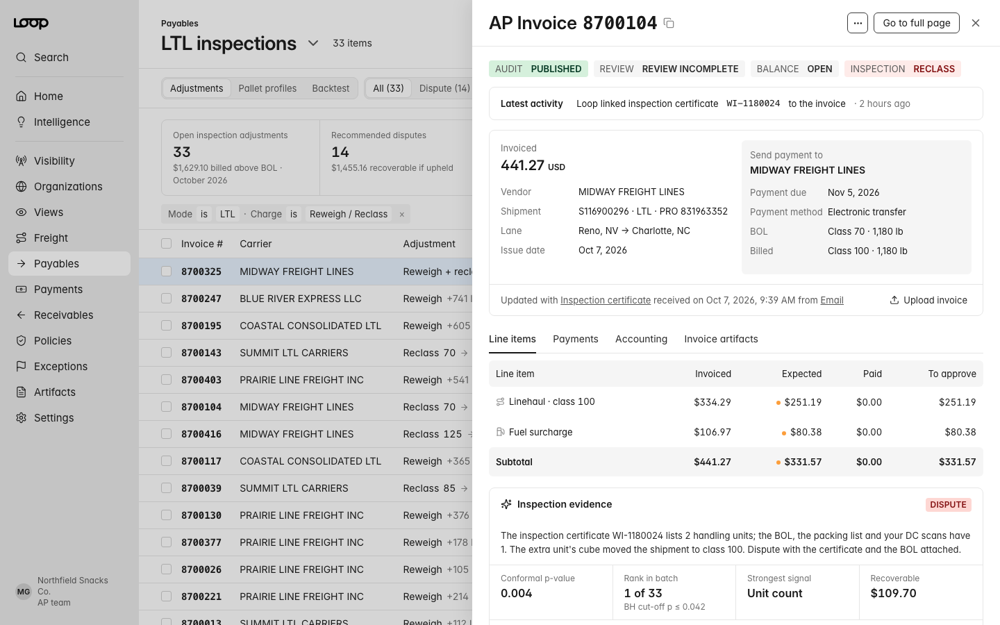

# Reclass Defense for Loop

**Live demo:** https://mohith26.github.io/loop-reclass-defense/

Since NMFC Docket 2025-1 (effective 19 July 2025) moved most LTL freight to the 13-step density scale, every inch a carrier's dimensioner reads on a pallet can move the class, and reweigh/reclass adjustments land on invoices with little more than an inspection certificate behind them. Loop's own guide says these disputes are winnable but the burden of proof sits with the shipper, and the documentation rarely exists at scale. Reclass Defense is a concept for a view inside Loop Payables that turns the shipper's own dimensioner and scale history into that proof: for every inspection adjustment it tests whether the carrier's measurement is plausible for these pallets, picks which ones to dispute with a stated bound on how many disputes will turn out wrong, and hands each one to the Exception Agent with an evidence packet. In a 200-shipper backtest it recovered **98.0%** of overbilled dollars while only **6.3%** of filed disputes were ones the carrier had right (target 10%); a fixed "density 10% off the BOL" rule recovered 94.8% with 24.6% wrong.



## What it does

* **Adjustments** (`#/inspections`): every open reweigh/reclass adjustment for the month, with the carrier's measured density, the 90% range your own scans predict for the same handling units, a conformal p-value, and a Dispute/Accept recommendation. A target selector (5/10/20% wrong disputes) re-runs the selection live. "Send N to Exception Agent" queues all recommended disputes.
* **Invoice panel** (`?id=<invoice>`): Loop-style AP invoice side panel with line items rerated at the BOL class, the strongest signal in plain words (extra handling unit, one pallet measured 6 in taller than its profile ever ships, overhang footprint, scale read 18% heavy), a density chart with the NMFC class bands, a per-unit table, the generated dispute note, and Dispute / Accept / Reopen actions. Evidence downloads as JSON.
* **Pallet profiles** (`#/profiles/<id>`): which SKUs' master data has drifted from what your dimensioner sees (so a reclass is *correct* and should be fixed upstream, not disputed), each profile's reclass risk under an accurate inspection, and a what-if slider for pallet height.
* **Backtest** (`#/backtest`): the 200-shipper evaluation below.

State (decisions, target) persists in `localStorage`; every view is deep-linkable. Keyboard: `/` search, `J`/`K` move, `Enter` open, `D` dispute, `A` accept, `Esc` close, `?` help. CSV and JSON export of the decision table.

## How it works

1. **Expected shipment from your own scans.** Each BOL handling unit maps to a pallet profile (SKU build). Robust per-profile statistics (median and 1.4826·MAD of height, weight and density) come from the shipper's DC dimensioner scans.
2. **Optimal unit matching.** The carrier's certificate lists handling units in arbitrary order; `assignUnits` finds the minimum-cost assignment of measured units to BOL units (exhaustive over permutations, n ≤ 7, which covers LTL).
3. **Nonconformity score.** The largest one-sided standardized residual among shipment density (lower = worse class), shipment weight (heavier), each matched unit's height (taller) and footprint (bigger), plus a hard flag for a handling-unit count mismatch.
4. **Conformal p-values.** Calibrated against the shipper's carrier-upheld inspection adjustments from the last 12 months (the outcomes Loop's Exception Agent already records). Under exchangeability with correct inspections each p-value is super-uniform (split conformal; Bates, Candès, Lei, Romano, Zrnic 2023, *Testing for outliers with conformal p-values*).
5. **Benjamini-Hochberg selection** at the chosen target. With conformal p-values this controls the expected share of filed disputes where the carrier was right (FDR), per shipper, without hand-tuned thresholds.
6. **Rerating.** Billed vs expected using the lane's class-50 CWT base, class multipliers, discount, minimum charge and fuel surcharge.

All logic lives in `src/core.js` (pure functions, no DOM). The browser computes every number on the page from `data/dataset.json` at load.

## Results (data/results.json, 200 simulated shippers, target 10%)

| Decision rule | Avg wrong-dispute rate | Worst-decile shipper | Shippers over 20% wrong | Overbilled $ recovered | Disputes / month |
|---|---:|---:|---:|---:|---:|
| **Reclass Defense** (BH on conformal p) | **6.3%** | 16.7% | 4% | **98.0%** | 13.0 |
| Fixed rule: density 5% off BOL | 52.2% | 71.0% | 98% | 99.5% | 27.2 |
| Fixed rule: density 10% off BOL | 24.6% | 50.0% | 53% | 94.8% | 14.5 |
| Fixed rule: density 20% off BOL | 1.4% | 0.0% | 2% | 82.0% | 7.8 |
| Dispute everything | 66.7% | 80.7% | 100% | 100% | 40.4 |

At a 5% target: 2.7% wrong, 97.1% of dollars. Each simulated shipper has its own master-data staleness (0-45% of profiles with 2-7 in height drift), carrier error rates (x0.5-1.5) and pallet-build variability, which is why a single fixed threshold is too timid for some shippers and floods carriers for others. The headline numbers are recomputed from scratch in the test suite.

## Data

Synthetic, seeded (`node data/generate.mjs`), loosely seeded from published figures: 48×40 GMA pallets of snack/candy/beverage SKUs at 40-72 in, a 14% inspection rate, error modes taken from common dispute reasons (measured to the highest point, overhang footprint, scale read including other freight, handling-unit count off by one). The NMFC density scale is the real FCDC 13-subprovision table (NMFTA Docket 2025-1, Disposition Bulletin 1371). Lane rates, discounts and the class multiplier curve are illustrative, not any carrier's tariff. Carrier and shipper names are fictional.

## Honest limitations

* The FDR bound assumes new correct inspections are exchangeable with the calibration set. A carrier that changes dimensioner hardware, or a shipper whose pallet builds drift quickly, breaks this; the fix is a rolling window or weighted conformal, which this demo does not implement.
* Calibration needs labeled outcomes (carrier upheld vs reversed). Loop has these from dispute resolution; a new customer would start with a conservative target until a few hundred outcomes exist.
* Units with no scan history fall back to master data, which is exactly what goes stale. The demo assumes every profile has scans.
* Only density-scale items are modeled. Items still classed by handling/stowability/liability (and the 77.5/110/150/200/500 classes) are out of scope.
* "Wrong dispute" is known only in simulation. In production the right check is the realized reversal rate per carrier, monitored against the target.

## Prior art and what is new

Reweigh/reclass auditing exists, but as rules against the BOL or document checks: Lighthouz auto-disputes adjustments that lack an inspection certificate; Warp's free reweigh/reclass audit and LanePilot recompute density from the BOL dimensions and flag mismatches; audit desks like ClearLane dispute when the charge "does not match the BOL"; dimensioner vendors (vMeasure, Cubiscan) sell the shipper-side measurements. Practitioner write-ups (e.g. SourceX) note that a reclass often means the product master is stale. Loop's own NMFC guide and its 2025 "audit tools aren't ready" post describe the problem but not a statistical test. I could not find a product that scores a carrier inspection against the shipper's own scan history and selects which adjustments to dispute with a false-dispute guarantee; the BOL-comparison rules above are what the backtest calls "fixed rule". Conformal outlier p-values with BH are from Bates et al. (2023); the application to freight inspections, the unit-matching score, per-shipper calibration on upheld disputes and the master-data drift view are the new parts here.

## Run it

```bash
node data/generate.mjs      # regenerate data/dataset.json and data/results.json
node --test test/*.test.mjs # 17 tests, including the headline-number check
python3 -m http.server      # then open http://localhost:8000
```

CI runs the tests and checks that the data script is deterministic (`.github/workflows/test.yml`).

---
Unofficial concept demo by Mohith Gajjela. Not affiliated with Loop. Synthetic data.
